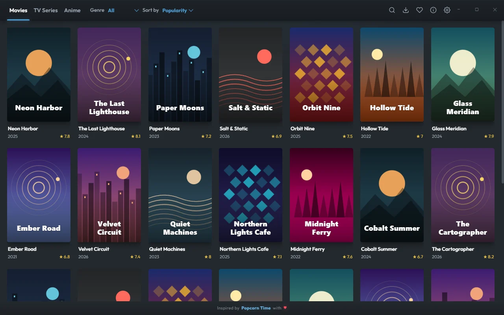
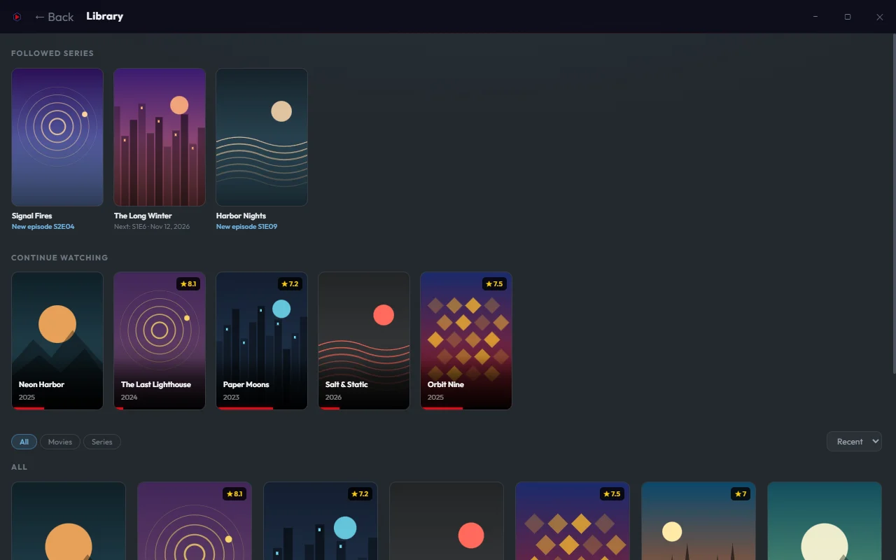
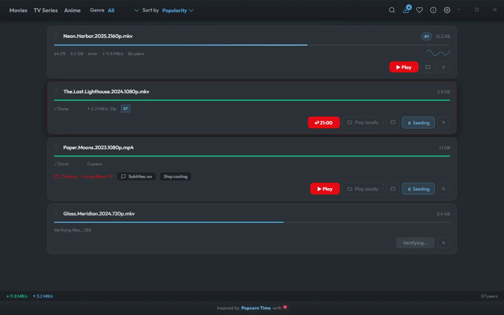
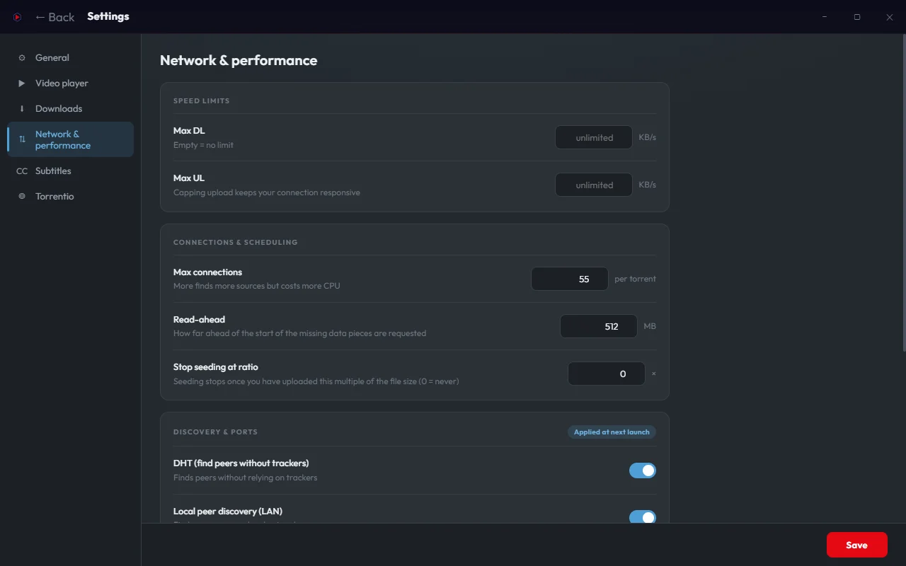

<div align="center">



<br>

<a href="https://github.com/AntoineVassort/TorrentPlayer/releases/latest"></a> <a href="https://github.com/AntoineVassort/TorrentPlayer/actions/workflows/ci.yml"></a>  <a href="https://github.com/AntoineVassort/TorrentPlayer/releases"></a> <a href="LICENSE"></a>


**Pick a title, press *Watch Now* — it downloads and plays at the same time, in the player you already use.**

<a href="#installation">Download</a> &nbsp;·&nbsp; <a href="#screenshots">Screenshots</a> &nbsp;·&nbsp; <a href="#highlights">Highlights</a> &nbsp;·&nbsp; <a href="#supported-players">Players</a> &nbsp;·&nbsp; <a href="CHANGELOG.md">Changelog</a>

</div>

<br>

TorrentPlayer downloads and streams simultaneously. It serves the file over a local HTTP server with range-request support, then launches your external player (VLC, mpv, MPC-HC…) directly with the URL. Seeking, subtitles and buffering are handled natively by the player — so there are **no codecs to ship and no transcoding**.

The interface is **inspired by Popcorn Time** — a poster wall you browse by Movies / TV Series / Anime, filter by genre and sort, with infinite scroll, a rich detail view (seasons, episodes, synopsis) and a clean full-screen download screen.

> **Windows-first.** macOS (Intel and Apple Silicon) and Linux builds are published with every release, but they are less tested than the Windows one.

---

## Screenshots

<table>
  <tr>
    <td width="50%" valign="top">
      <a href="docs/screenshots/discover.webp"></a>
      <br><sub><b>Browse</b> — a poster wall with genre and sort filters, and infinite scroll.</sub>
    </td>
    <td width="50%" valign="top">
      <a href="docs/screenshots/library.webp"></a>
      <br><sub><b>Library</b> — Continue Watching with resume progress, then your series and movies. <i>Screenshots use generated demo artwork.</i></sub>
    </td>
  </tr>
  <tr>
    <td width="50%" valign="top">
      <a href="docs/screenshots/downloads.webp"></a>
      <br><sub><b>Downloads</b> — live speed, resume position, casting and file-verification progress.</sub>
    </td>
    <td width="50%" valign="top">
      <a href="docs/screenshots/settings.webp"></a>
      <br><sub><b>Settings</b> — speed limits, connections, read-ahead and network options, with sensible defaults.</sub>
    </td>
  </tr>
</table>

---

## Highlights

<table>
  <tr>
    <td width="33%" valign="top"><b>⚡ Watch while it downloads</b><br>Playback starts as soon as enough is buffered. Seeking, subtitles and buffering stay in your player.</td>
    <td width="33%" valign="top"><b>🎬 Popcorn Time–style browsing</b><br>Movies, series and anime, with genres, sorting, a detail view and a seasons / episodes layout.</td>
    <td width="33%" valign="top"><b>📺 Cast anywhere</b><br>Chromecast and DLNA/UPnP, with subtitles and on-the-fly AAC audio for formats receivers can't decode.</td>
  </tr>
  <tr>
    <td valign="top"><b>⏯️ Pick up where you left off</b><br>Continue Watching with the exact position for mpv and VLC. Follow a series and get new-episode alerts.</td>
    <td valign="top"><b>⚙️ Tunable, with good defaults</b><br>Speed limits, connections, read-ahead, seed ratio, DHT / NAT / encryption — and one click to restore defaults.</td>
    <td valign="top"><b>📦 Built for big files</b><br>A sliding download window and live verification progress keep 20 GB+ torrents smooth.</td>
  </tr>
</table>

<details open>
<summary><b>Everything it does</b></summary>

<br>

- **Browse** — a Popcorn Time–style poster wall of popular movies, series and anime, with **Genre** and **Sort** filters and **infinite scroll** that loads more as you go (metadata from Cinemeta & Kitsu)
- **Detail view** — click any title for a full-screen page: backdrop, synopsis, rating, and for series a **Seasons │ Episodes │ Episode-info** layout with one-click **Watch Now**
- **Download screen** — a clean full-screen view while a pick buffers (progress, speeds, peers, cancel); the player launches automatically once there's enough to play
- **Search** — find movies, series and anime via [Torrentio](https://torrentio.strem.fun), with quality shortcuts (4K / 1080p / 720p / 480p)
- **Stream while downloading** — playback starts before the download completes
- **Continue Watching** — resume where you left off; the library shows a progress bar and a one-click resume
- **Auto-play next episode** — when an episode ends, the next one is fetched and played automatically (toggle in Settings)
- **Follow series** — ★ follow a series to get notified when a new episode airs; download it in one click, or auto-download (opt-in)
- **Watched & downloaded checks** — every episode and movie shows whether it was watched and downloaded (recorded automatically, kept even if the file is deleted); check them by hand — one episode or a whole season — for what you watched or downloaded elsewhere
- **Quality auto-pick** — set a preferred quality (4K / 1080p / 720p / 480p) and the best matching stream is added automatically, skipping the stream list
- **Resume position** — saved and restored for both mpv (IPC) and VLC (HTTP interface)
- **Subtitles** — uses `.srt` / `.ass` / `.ssa` / `.vtt` / `.sub` files shipped in the torrent, and can auto-fetch from OpenSubtitles when none are present
- **Smart queue** — download one at a time, drag to reorder
- **Stuck-download recovery** — when a torrent finds no peers, switch to another release (series/anime) or retry the search in one click; warns when disk space is low
- **Library** — sorted into Continue, Series, Movies and Other. One card per series with "x/y watched" and the next episode's state (up next / new / up to date); clicking a series opens it on that episode, ready to play or download. Every series in the Library is checked for new episodes, and the Library refreshes on its own (metadata via Cinemeta and TVmaze, no API key)
- **Cast** — stream to Chromecast or DLNA/UPnP devices on your local network. Subtitles (embedded in the MKV, shipped with the torrent, or from OpenSubtitles) are sent as a track you can toggle from the app; audio the receiver can't decode (E-AC-3, AC-3, DTS) is converted to AAC on the fly with a bundled ffmpeg
- **Network & performance settings** — a dedicated Settings page: max download / upload speed, max connections per torrent, read-ahead window, stop-seeding ratio, and DHT / local discovery / UPnP-NAT-PMP / web seeds / protocol encryption / listening port. Sensible defaults, one-click "restore defaults"
- **Verification progress** — when a big torrent re-checks its files after a restart, its card shows the real progress ("Verifying files… 42 %") and can be cancelled
- **Big-file friendly** — the download is scheduled in a sliding window ahead of the missing data, so 20 GB+ torrents no longer saturate the app's main thread
- **Keyboard shortcuts** — <kbd>Ctrl</kbd>+<kbd>K</kbd> (or <kbd>/</kbd>) opens the search, <kbd>Esc</kbd> goes back
- **Languages** — English & French
- **Auto-update** — download and install new versions from inside the app, in one click
- **System tray** — closing the window minimizes to tray; tray shows live download speed
- **Clipboard detection** — paste a magnet link and the app picks it up automatically

</details>

---

## Installation

**No Node.js required.** Download the archive for your system, extract it anywhere and run the app:

<p align="center"><a href="https://github.com/AntoineVassort/TorrentPlayer/releases/latest/download/TorrentPlayer-Windows-x64.zip"></a> <a href="https://github.com/AntoineVassort/TorrentPlayer/releases/latest/download/TorrentPlayer-macOS-arm64.zip"></a> <a href="https://github.com/AntoineVassort/TorrentPlayer/releases/latest/download/TorrentPlayer-macOS-x64.zip"></a> <a href="https://github.com/AntoineVassort/TorrentPlayer/releases/latest/download/TorrentPlayer-Linux-x64.zip"></a></p>

1. Go to [Releases](../../releases/latest) (or use the buttons above)
2. Download `TorrentPlayer-Windows-x64.zip`
3. Extract anywhere
4. Run `TorrentPlayer.exe`

The macOS archives are `TorrentPlayer-macOS-x64.zip` and `TorrentPlayer-macOS-arm64.zip`, and the Linux one is `TorrentPlayer-Linux-x64.zip` (less tested than Windows). See the [CHANGELOG](CHANGELOG.md) for what changed in each version.

On first launch the app shows a short disclaimer, then helps you pick a video player. It auto-detects the players installed on your machine (see below); you can also browse to any other player manually. No further configuration required.

---

## Supported players

| Player    | Auto-detected on            | Resume position |
|-----------|-----------------------------|-----------------|
| mpv       | Windows, macOS, Linux       | ✓ (IPC)         |
| VLC       | Windows, macOS, Linux       | ✓ (HTTP)        |
| MPC-HC    | Windows                     | —               |
| MPC-BE    | Windows                     | —               |
| PotPlayer | Windows                     | —               |
| IINA      | macOS                       | —               |
| MPlayer, SMPlayer, Celluloid | Linux    | —               |

> mpv is recommended for the smoothest HTTP streaming. Any other player that accepts a URL can be added with **Settings → Video player → Browse…**

---

## Optional: OpenSubtitles

If a torrent has no embedded subtitles, TorrentPlayer can fetch them automatically.

1. Create a free API key at [opensubtitles.com](https://www.opensubtitles.com/en/consumers)
2. Open **⚙ Settings → Subtitles**
3. Pick a subtitle language and paste your API key

> Settings is organised in a side navigation: General, Video player, Downloads, Network & performance, Subtitles and Torrentio.

---

<details>
<summary><b>For developers</b></summary>

<br>

> Node.js is bundled in the release exe — end users don't need to install anything.

```bash
git clone https://github.com/AntoineVassort/TorrentPlayer
cd TorrentPlayer
npm install      # requires Node.js 22+ (WebTorrent v3)
npm start        # dev mode
npm run cli -- "<magnet>"   # headless CLI: download + launch your player, no UI
npm run lint     # ESLint (correctness checks)
npm run dist     # build Windows exe → dist/TorrentPlayer-win32-x64/
npm run dist:mac-x64 / dist:mac-arm64 / dist:linux   # other platforms (build on the matching OS)
```

Releases are built by GitHub Actions when a `vX.Y.Z` tag is pushed; the release notes are taken from the matching section of the [CHANGELOG](CHANGELOG.md).

**Stack:** Electron · WebTorrent v3 · Vanilla JS (no framework) · ESM

</details>

---

## Legal

TorrentPlayer is a neutral tool. It does not host, index or distribute any content. Users are solely responsible for what they download. Only use it with content you have the right to access.

---

## License

[MIT](LICENSE)

<div align="center">
<br>
<sub>Inspired by Popcorn Time, with ♥</sub>
</div>
